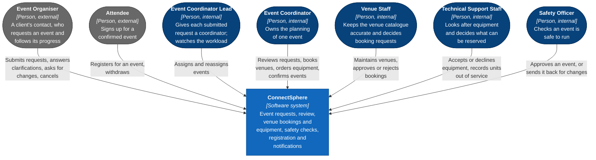
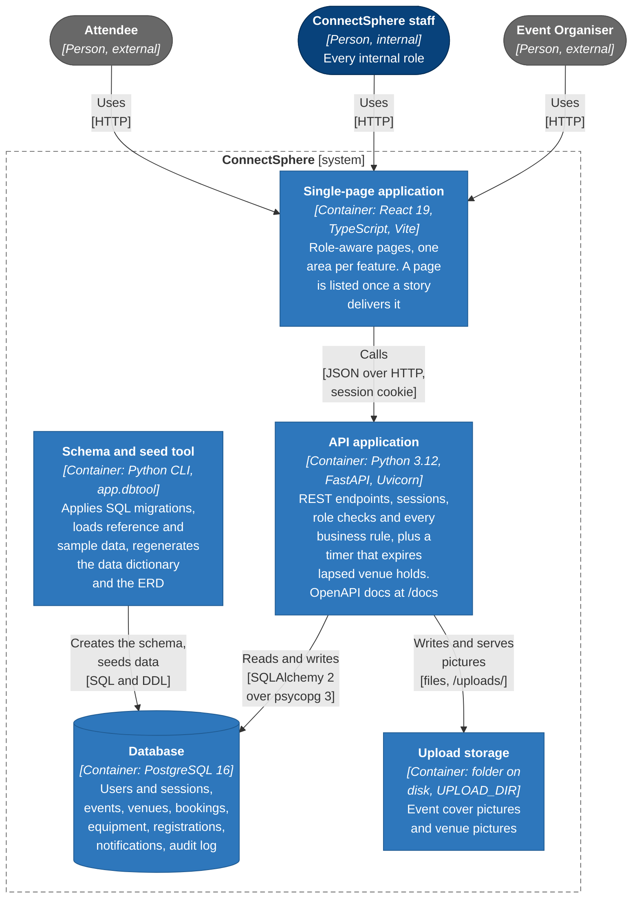
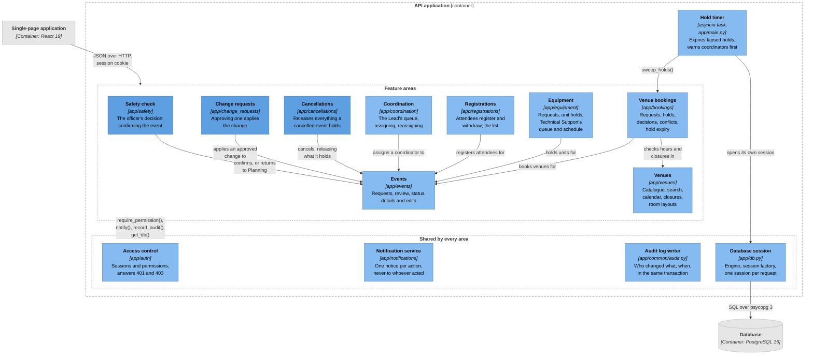
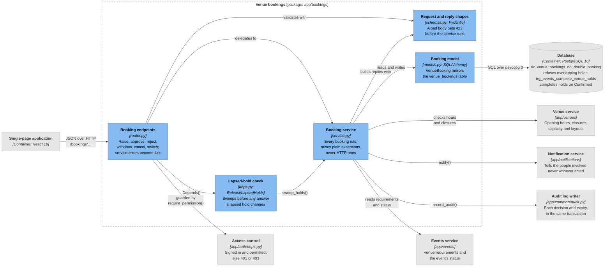
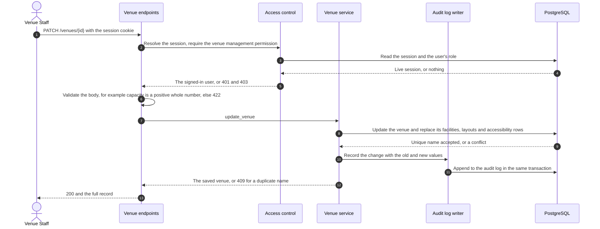
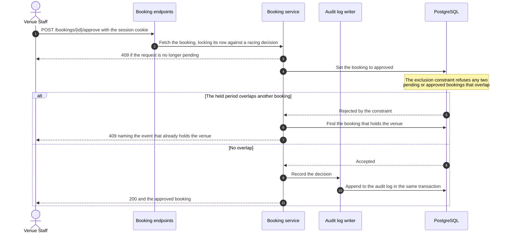
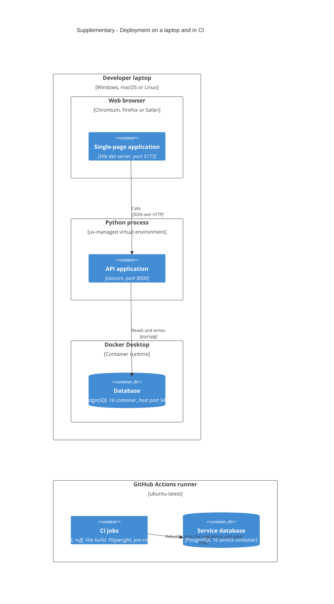

# C4 model

How ConnectSphere is put together, described with the [C4 model](https://c4model.com): context,
containers, components, plus a dynamic and a deployment view. The scope is the **first release**,
the 20 core features listed in the Week 4 project instructions.

This file is written by hand. The data dictionary and ERD under `docs/database/` are generated
from the live schema and describe the data; this file describes the software.

## How to read it

- Each component names the package that implements it, such as `app/bookings`. A component with
  no package yet names the epics it serves instead: the backlog asks for it and the database
  already has its tables, but no application code exists. The schema deliberately runs ahead of
  the code, so a table is not evidence of a feature.
- Which stories are done is tracked in the backlog, not here. This file changes when a feature
  area, a container or a responsibility does.
- Diagrams are Mermaid flowcharts drawn in C4 notation, which lay out more cleanly than
  Mermaid's own C4 diagrams. Dark blue is a person inside ConnectSphere Event Services and grey
  one outside it; blue is the software system and its containers; light blue is a component of
  the container being zoomed into, and light grey anything outside that zoom. A dashed line is a
  boundary, and an arrow from a boundary applies to everything inside it.
- GitHub renders the diagrams in place. In VS Code, use the Markdown Preview Mermaid Support
  extension. To move things around visually, paste a diagram into
  [mermaid.live](https://mermaid.live), then copy the text back.

## Level 1: system context

Who uses ConnectSphere and what they use it for. The first release has no external system
dependencies: notifications are in-app only, and there is no e-mail, calendar or payment
integration.

## Level 2: containers

The parts that run separately and how they talk to each other.

Each container in one line:

| Container | Technology | Responsibility |
| --- | --- | --- |
| Single-page application | React 19, TypeScript, Vite on port 5173 | Shows each role only what its permissions allow. Holds no rules of its own |
| API application | FastAPI on port 8000 | Every rule and every access decision. One module per feature area, plus the timer that expires lapsed venue holds |
| Database | PostgreSQL 16 on port 5433 | The single copy of event, venue, equipment and registration data. Enforces the rules that must never be broken |
| Upload storage | A folder on disk, `UPLOAD_DIR` (`backend/uploads` by default) | Event cover pictures and venue pictures, written by the API and served at `/uploads/events/` and `/uploads/venues/` |
| Schema and seed tool | `python -m app.dbtool` | Migrations, seed data, and the generated data dictionary and ERD |

## Level 3: components of the API application

Inside the API application. Each feature area is one package with the same four files: a router
for HTTP, a service for rules, schemas for request and response shapes, and models for tables.
`app/main.py` registers every area's routers, so a request from the single-page application lands
in its area's `router.py`. The three workflows that act on an event across areas (safety check,
change requests, cancellations) are the darker blue, and every area uses the same shared
services.

Arrows show the main calls. The code has more: the workflows also release bookings, equipment and
registrations in their own areas, the notification service reads back into the areas to work out
where each notice opens, and venues, bookings and events read one another. The queue search and
the phone number rule in `app/common` are left out.

What each component does:

| Component | Package | Responsibility |
| --- | --- | --- |
| App entry point | `app/main.py` | Creates the FastAPI app, applies CORS, registers every feature area's routers, serves `GET /health` |
| Hold timer | `app/main.py` | Runs `bookings/service.py::sweep_holds` every `HOLD_SWEEP_INTERVAL_SECONDS` with its own session: warns coordinators of holds about to expire, then expires the lapsed ones |
| Safety check | `app/safety`, epic 21 | The Safety Officer's queue of events awaiting the operational safety check, and each event's safety facts: attendance, approved venues judged against their capacity in the booked layout, accessibility needs, accepted equipment, previous reviews and what changed since the latest. The coordinator's request for a review once every arrangement is secured, the officer's decision against the review factors with findings of what must change, and confirming an approved event no change request has been approved since |
| Change requests | `app/change_requests`, epic 19 | An organiser's requested changes to an approved event, one pending per field, and their withdrawal; the assigned coordinator's queue of them and decision on each. Approving applies the change by the event's own rules, reused from `app/events`, releases only the bookings and equipment it affects, and returns an event past Planning to Planning for a new safety check. Before deciding, the coordinator sees the impact approving would have, worked out by the same rules and checked again when approving |
| Cancellations | `app/cancellations`, epic 6 | The organiser cancelling their own event with a reason. One transaction, under the event's row lock: its pending and approved bookings and its equipment holds are released, its open equipment items, registrations and pending change requests closed and kept for the record, and who cancelled it, when and why recorded. The coordinator (or the Lead, before one is assigned), the attendees, Venue Staff and Technical Support are told |
| Coordination | `app/coordination`, epic 5 | The Lead's unassigned queue and first assignment, the Lead's overview of every active event and each coordinator's workload, and the Lead's reassignment of an event to another coordinator |
| Events | `app/events`, epics 2, 3, 4, 6, 7 | Drafts, submission, event details and requirements, status transitions, routine edits. The review queue, clarification conversation, approve or reject. The equipment an event request asks for, and its hold on submission. An event's registration settings |
| Venue bookings | `app/bookings`, epics 12, 13, 14 | Booking requests and the venue hold, withdrawals, decisions with reasons, conflict detection over the held period. An approved booking's hold until its event is confirmed: the expiry Venue Staff set as they approve and their changes to it, and the sweep that warns coordinators and expires lapsed holds, run on the API's timer and before any answer a lapsed hold would change. The database completes the holds when an event becomes Confirmed |
| Registrations | `app/registrations`, epic 18 | The Confirmed, Public events taking registrations, each with its booked venues, places left and state for the attendee, and registering: the opening and closing times, capacity and one registration per attendee checked while holding the event's row, with the database's one-active-registration index behind it. An attendee's own registrations, one per event, and withdrawing one until the event starts, in one conditional update with its audit entry. An event's registration list for its organiser and assigned coordinator once past draft, a page at a time, with its active count against capacity read in the same statement, each Registered attendee's phone number and dietary requirements, and the events whose list they can pick. The attendee's own profile: their name, phone number and dietary requirements, saved on My profile or with a registration, which confirms them every time and must give them the first time |
| Equipment | `app/equipment`, epics 15, 16, 17 | The coordinator's equipment requests: recording items, holding their units, submitting them to Technical Support, and re-checking them when an event's dates change. Technical Support's queue of the requests sent to it, with what is available for each, and its decision on each: accepting keeps the hold as the reservation, declining releases it. The equipment catalogue and the units recorded out of service. Technical Support's schedule of every hold still to end, by equipment type, filtered by type and dates |
| Venues | `app/venues`, epics 8, 9, 10, 11 | Listing, searching, reading, creating, updating and deleting venues, each venue's availability calendar, the pick-list reference data, and the room layouts Venue Staff add, rename and delete. Venue rules: required fields, unique name, known reference codes, valid operating hours, and refusing to delete a venue that bookings still refer to; a room layout's unique name, and refusing to delete one still in use. Search and filter, and suitability against capacity, facilities and layout. Venue Staff's closures: a saved closure, once Venue Staff confirm the bookings listed, rejects the venue's pending requests it covers and cancels its approved bookings, returns their Confirmed events to planning and tells their people |
| Access control | `app/auth`, epic 1 | Sign-in and sign-out (`POST /auth/login`, `POST /auth/logout`, `GET /auth/me`), scrypt password hashing with constant-time verification, server-side sessions, the permission list per role, and the dependencies that answer 401 and 403 |
| Notification service | `app/notifications`, epic 20 | One notification per significant action, to the related users and never to whoever acted; each user's own list, which of its notifications are read, the unread count, and where opening each one goes for its reader |
| Audit log writer | `app/common/audit.py` | Appends who changed what and when, inside the caller's transaction |
| Database session | `app/db.py` | Engine, session factory and the per-request session |

## Level 3: inside venue bookings

One feature area drawn file by file, `app/bookings`, as the worked example; every other area has
the same shape. The router speaks HTTP, the service holds every rule, and the database has the last
word on double booking.

The hold timer in `app/main.py` (the Level 3 view above) calls the same `sweep_holds()` as the
lapsed-hold check, on its own schedule. A hold ends one of two ways: the timer or the lapsed-hold
check expires it, or `trg_events_complete_venue_holds` completes it when its event becomes
Confirmed. The dynamic view of approving a booking, further down, shows the exclusion constraint
at work when two staff approve at once.

## Dynamic view: Venue Staff updates a venue

Story 8.3. It shows where each kind of refusal comes from, which is the same pattern every
feature follows.

## Dynamic view: approving a venue booking

Stories 12.1, 13.2 and 14.2. It is drawn because it is the design decision most worth
explaining. A pending request already holds its venue, so an overlapping request is refused when
it is raised. At approval the database still has the last word: its exclusion constraint refuses
any two pending or approved bookings that overlap, even when two staff members approve at the same
moment, and the service turns that refusal into a readable conflict.

## Deployment view

The first release is coursework and runs locally. Nothing is hosted, so this view covers a
developer machine and the CI runner.

Host port 5433 is deliberate. A PostgreSQL installed directly on a laptop usually holds 5432 and
would answer instead of the project's container.

## Core features mapped to components and tables

The 20 core features from the Week 4 instructions, the component that owns each one, the tables
behind it, and the package whose code implements it so far ("—" where there is none yet). Epic
numbers match the product backlog story IDs, so feature 8 is story 8.x.

| # | Core feature | Component | Main tables | Code |
| --- | --- | --- | --- | --- |
| 1 | User authorisation and authentication | Access control | `roles`, `users`, `user_sessions` | `app/auth` |
| 2 | Event request creation | Events | `events`, `venue_requirements`, `venue_requirement_facilities`, `event_accessibility_needs`, `event_equipment_requests` | `app/events` |
| 3 | Draft event requests | Events | `events` with status `DRAFT` | `app/events` |
| 4 | Event review and approval | Events | `events`, `event_status_history`, `event_clarifications` | `app/events` |
| 5 | Coordinator assignment | Coordination | `event_coordinator_assignments`, `events.assigned_coordinator_id` | `app/coordination` |
| 6 | Event status management | Events, Cancellations | `events.status`, `event_status_history`, the `events.cancelled_*` columns | `app/events`; `app/cancellations` for the organiser cancelling an event and releasing what it holds |
| 7 | Event information management | Events, Audit log writer | `events`, `event_change_history`, `audit_log` | `app/events`; `app/change_requests` records an approved change in the history |
| 8 | Venue catalogue | Venues | `venues`, `venue_facilities`, `venue_layouts`, `venue_accessibility_features`, `room_layouts`, `deleted_room_layouts` | `app/venues` |
| 9 | Venue availability calendar | Venues | `venue_unavailability_periods`, `venue_bookings` | `app/venues` |
| 10 | Venue search and filtering | Venues | `venues` and its join tables, `venue_bookings` | `app/venues` |
| 11 | Venue suitability checking | Venues | `venues.capacity`, venue join tables against event requirements | `app/venues`, as search filters |
| 12 | Venue booking request | Venue bookings | `venue_bookings`, including the link between a replaced booking and its replacement | `app/bookings` |
| 13 | Venue booking approval | Venue bookings | `venue_bookings` decision columns | `app/bookings` |
| 14 | Booking conflict detection | Venue bookings, plus a database exclusion constraint | `venue_bookings.held_from` and `held_until` | `app/bookings`, and the constraint |
| 15 | Equipment request management | Equipment | `event_equipment_requests`, `equipment_types` | `app/equipment`; `app/events` for requests made with an event |
| 16 | Equipment availability checking | Equipment | `equipment_types.total_quantity`, `equipment_reservations`, `equipment_unavailability_periods` | `app/events` for any dates; `app/equipment` for an event, counting what it holds |
| 17 | Equipment reservation | Equipment | `equipment_reservations` | `app/events` for the hold made on submission; `app/equipment` for the coordinator's holds and Technical Support's schedule of them |
| 18 | Attendee registration | Registrations | `event_registrations`, `event_registration_guests`, registration columns on `events`, and the attendee's `users.phone`, `users.dietary_requirements` and `users.attendee_details_confirmed_at` | `app/registrations`; `app/events` for an event's registration settings; `app/common/phone.py` for the phone number rule |
| 19 | Event change requests | Change requests | `event_change_requests` | `app/change_requests`; `app/events` for the point of contact updated directly and for applying an approved change; `app/bookings` and `app/equipment` for what an approval releases; `app/safety` refuses to confirm on a safety approval older than an approved change; `app/registrations` and `app/venues` read for the impact of a pending change |
| 20 | Notification system | Notification service | `notifications` | `app/notifications` |

Auditability runs across all of them. Every significant action appends to `audit_log` through one
writer, so no feature has to invent its own history.

## Decisions these diagrams encode

- **One module per feature area, not one per technical layer.** A story touches a single folder,
  which keeps parallel work in a six-person team from colliding.
- **Rules live in services, never in routers or the UI.** A router validates shapes and maps
  errors to status codes. The single-page application decides only what to show.
- **Role permissions are a list in code; relationship rules sit in services.** "Which role may
  book a venue" is a permission. "A coordinator sees only their own events" needs the record, so
  it belongs next to it.
- **The database enforces what must never break.** Two overlapping bookings that hold a venue,
  pending or approved, are impossible because of an exclusion constraint, not because the service
  remembered to check.
- **Sessions live in the database.** Logging out revokes the row, so a stolen cookie stops
  working immediately.
- **The schema covers the whole backlog, the code does not.** That keeps later stories from
  needing migrations that reshape existing tables.

## Keeping this file honest

Update it when you add a feature area, change a container or move a responsibility between
components. A new feature area is a node in the Level 3 diagram and a row in the table under it.
Nothing regenerates it. The checklist in [ARCHITECTURE.md](ARCHITECTURE.md) and
[AGENTS.md → Keeping Docs Current](../AGENTS.md#keeping-docs-current) list the other places a new
feature has to appear.
